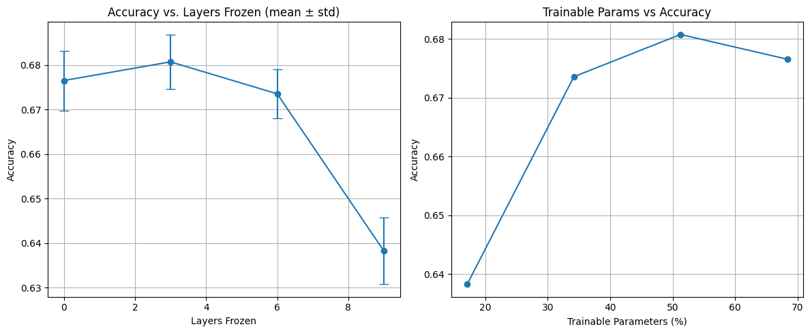

# Probing next-token predictions across transformer layers

I ran a small experiment to test part of the intuition from my previous post: that deeper transformer layers build representations that are more useful for prediction. My initial hypothesis was that next-token accuracy from a linear probe would improve at every layer. The result improved through the early layers and then plateaued.

I used an off-the-shelf transformer in Google Colab and attached a linear prediction head to each layer's output. Each probe tried to predict the next token from the representation available at that layer. Comparing their accuracy gave me a rough measure of how accessible the predictive information was to that particular readout.

## What I observed

Accuracy increased from Layer 0 through Layer 3. After Layer 3, the curve flattened. That is the observation the experiment supports: under this setup, the later representations did not produce continued improvements in linear-probe accuracy.

At first, I interpreted the early increase as support for my prediction-cascade idea. Deeper computation appeared to make the representation more useful to the probe. The plateau forced me to be more precise about what I was measuring. Probe accuracy is a property of the representation, the readout, its training, and the evaluation data together.

## What the plateau might mean

One possible explanation is that early layers build representations that are easy for a linear head to use, while later layers perform transformations the probe does not capture well. I imagined the early layers emphasizing local structure and the later layers combining information over longer ranges. That is a hypothesis about the mechanism, rather than a result established by the graph.

There are simpler alternatives. The probes may have been insufficiently trained, the dataset may have limited what they could learn, or a linear readout may already have reached the useful ceiling for this setup. Information can also be present without being accessible to the chosen probe. A flat curve does not establish that the model stops processing information after Layer 3.

To distinguish these explanations, I would need to change the probe or the task and see whether the plateau moves. Better-trained linear probes would test whether readout training was the bottleneck. Nonlinear probes could test whether predictive information had become less linearly accessible, although their added capacity would introduce its own interpretation problem. Tasks that require long-range information could test the specific story I was telling about deeper layers.

## What this first experiment changed

The setup had clear limits: a small model, lightly trained probes, and free Colab compute. I would not use it to make a general claim about transformer layer roles. It did give me a concrete result that my original explanation had to accommodate, which was more useful than leaving the intuition untested.

I learned that an experiment can answer a narrower question than the one that motivated it. My broad question was how a transformer develops useful abstractions. My measurement was how well a linear head predicts from each layer under one configuration. Keeping those two levels separate makes it easier to decide what to test next.

The [code and results](https://github.com/AymanMahfuz27/layer-freezing-gpt-finetune/tree/main) are available in the repository. I want to extend this with larger models, better-controlled probes, and direct comparisons of how representations change across layers.
