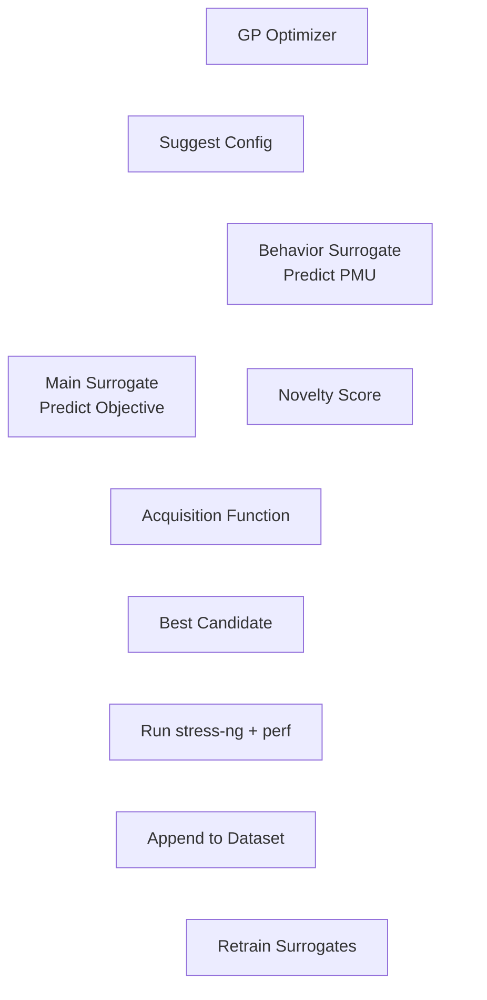

# ML-guided hardware stress testing at Arm

This summer at Arm, I built a pipeline that uses machine learning to find `stress-ng` configurations that put high pressure on a target part of the system. The project began with an open-ended suggestion to try ML for validation. I turned it into a search problem: given a limited number of tests on real hardware, find workloads that expose behavior ordinary configurations might miss.

The difficulty is that a stress-test configuration specifies the workload we request. It does not tell us how the machine will respond. CPU scheduling, memory bandwidth, I/O, and interactions between stressors determine the pressure that actually reaches the hardware. We need measurements to know whether a particular combination is doing what we intended.

## Why the configuration is an optimization problem

Consider setting `--cpu 80` on an 80-core machine. That asks `stress-ng` to launch CPU stressors, but it does not guarantee that all resources sustain their maximum useful activity. A memory bottleneck or scheduling constraint may limit the workload. Adding more of one stressor can also make another less effective.

I saw these interactions when varying thread counts, memory operations, and other options. Some combinations stalled at one limiting resource. Others produced higher pressure by distributing the workload differently. The useful configurations were not necessarily the ones with every parameter set to its maximum.

The search space has dozens of tunable parameters, including counts, sizes, and categorical methods. Each hardware test can take 30–60 seconds. Exhaustively testing the combinations would require too many runs, while random sampling could spend most of the budget on configurations that tell us little about the extreme cases.

I treated the machine as a **black-box objective**. A configuration goes in, measured hardware behavior comes out, and a learned surrogate estimates the relationship between them. The optimizer uses those estimates to decide which configuration is worth measuring next.

## Defining a valid search space

The pipeline first scans the hardware and operating-system limits. Commands such as `lscpu` and `lsmem` help build a structured profile of the available CPUs, memory, and related constraints. I also gather information about supported instructions, disks, network resources, and relevant kernel limits. The profile becomes an input to the search-space generator.

The generator defines parameter ranges for that host instead of assuming that the same ranges suit every machine. A 32-core host might permit CPU stressor counts up to 32. A machine with 128 GB of RAM and 100 GB free might cap a memory stressor at 80 GB. Those are examples of the relationship between a host profile and its parameter bounds, rather than universal settings.

I query the installed `stress-ng` version for supported methods so the generated space corresponds to options the tool can run. The output is a JSON definition of the tunable flags, their ranges, and their categorical choices. A global memory constraint also checks combinations, because individually valid allocations can exceed the available memory when used together.

These checks reduce the risk of generating invalid or excessive workloads. They do not establish that every valid configuration is harmless: stressing a real system can expose failures, and the host's available resources can change during a run. In my tests, the proposed configurations remained within the resource envelope I had defined.

## Collecting the first measurements

I seed the search with a Sobol sequence. Its low-discrepancy structure spreads the initial samples across the parameter space more systematically than independent random draws. The aim is to give the first surrogate a varied dataset before it starts favoring promising regions. Mapping the samples into mixed parameter types and applying constraints still matters to the coverage we actually obtain.

For each configuration, the pipeline runs `stress-ng` for a fixed duration, such as 30 seconds, and collects metrics with Linux `perf`. These include events and rates related to CPU activity, cache misses, page faults, context switches, and other system behavior. I log the requested configuration alongside the measurements so the model learns from what the machine did, rather than what the flags appeared to promise.

The collection step also derives useful features from raw counters, including rates where needed. Timing has to be consistent because a count collected over a different interval is not directly comparable. I later fixed a timing bug in this part of the pipeline, which improved the consistency of the measurements.

## Two surrogates with different jobs

The main surrogate is a Random Forest regressor that predicts a scalar objective, such as page-fault rate, from a configuration. It provides a way to rank candidate workloads without running all of them on the machine. Random Forests were useful for this mixed, nonlinear search space and for measurements affected by operating-system noise.

The behavior surrogate is a second Random Forest that predicts a vector of system measurements. I refer to this as the PMU vector, though the collected behavior includes events such as page faults and context switches as well as hardware performance counters. This model estimates how a workload behaves, rather than reducing everything to the chosen objective.

I pass the predicted vector into a novelty calculation. The measurements are z-scaled, and the distance to the nearest observed behavior becomes a novelty score. Scaling prevents a large numerical range in one component from dominating the distance. The score gives the search a reason to investigate a workload that may behave differently even if its predicted objective is not the highest.

The two signals serve different purposes. The objective predictor favors configurations likely to produce pressure on the target metric. The novelty score encourages coverage of behavior the dataset does not already contain. Their combination can help avoid repeatedly sampling the same region, although novelty is only as meaningful as the measurements and distance function that define it.

## Using a Gaussian process to search the surrogate

I use `gp_minimize` to search over the score produced by the Random Forest predictions and the acquisition calculation. This creates two levels of modeling. The forests learn from expensive hardware observations. The Gaussian-process optimizer explores the much cheaper surrogate score to select a candidate for the next real test.

That distinction matters. The GP's view of uncertainty is about its modeled objective in the inner search; it should not automatically be treated as calibrated uncertainty about the hardware. It can search the forest's prediction surface efficiently, but it can also exploit errors in that surface. The next hardware run is what tells us whether the candidate actually works.

The loop is:

After the selected workload runs, I append the measurements to the dataset and retrain the surrogates. The next search starts from a better-informed model. Logging and diagnostics let me inspect whether the optimizer is repeating itself, proposing out-of-range values, or relying on predictions that the hardware fails to confirm.

## What the experiments showed

The pipeline found configurations with higher objective values than the manual and random configurations I had tried. In the page-fault experiment, the best result was around 346 faults per second, and several runs converged near 345–347 faults per second. That repeatability was useful evidence that the result was not an isolated noisy measurement.

I initially interpreted the convergence as reaching the machine's practical limit. The stronger conclusion is narrower: the search repeatedly found a similar high-performing region under the tested workload, measurement method, and constraints. Proving an absolute hardware limit would require ruling out limitations in the search space, optimizer, and measurement setup. Convergence alone does not do that.

In one experiment, the top configuration was in the 99.8th percentile of all tested configurations. The comparison is to that tested population, rather than every configuration the machine could run. It still showed that the optimizer could concentrate a limited test budget on unusually strong candidates.

The measurement work was as important as the search algorithm. Fixing the timing bug moved the results from medium to high confidence in my internal scoring, but those labels were diagnostics, not formal uncertainty estimates. A model trained on inconsistent measurements would have learned those inconsistencies along with the hardware behavior.

## What I owned and learned

I had substantial autonomy on this project. I researched the problem, proposed the approach and backup plans, looked for related case studies, built the proof of concept, and implemented the pipeline. I wrote the code independently. The system brought together Linux measurements, shell commands, Python models, optimization libraries, and hardware constraints in one repeatable process.

I presented it to my team, my director, and the SVP, and began explaining the approach to other teams. At the time of writing, Arm was considering patenting the work. I had also been considering names such as NOVA, for Novelty-driven Objective-space Validation & Acquisition, Hydra Forest Optimization, ARES, for Automated Regression & Exploration System, and Manticore.

The part I found most useful was watching a measurement contradict an intuitive choice of flags. The model sometimes proposed a combination I would not have selected manually, and the hardware result made clear why parameter magnitude was a poor substitute for observation. Building the optimizer forced me to define what I meant by stress and what evidence would show that I had produced it.

## Where I would take it next

I want to investigate Deep Kernel Learning as an alternative when Gaussian-process search becomes difficult in higher dimensions. Multi-objective optimization is another direction: maximizing CPU pressure and network activity together may expose tradeoffs that a single scalar objective hides. A small dashboard would also help other engineers inspect the search and its measurements while it runs.

There is a broader application to large systems, where rare failures can become frequent events simply because many machines are running. I was thinking about that after the OpenAI GPT-4.5 podcast discussed failures at scale. Extending this approach to a cluster would require handling interference, scheduling, and measurements across hosts; success on one machine would not establish that those problems are solved.

The project gave me a working way to search for stressful workloads and a better understanding of how to validate the search itself. I also gave a presentation on the history of deep learning to more than 30 ML employees and enthusiasts, covering ideas from perceptrons through Solomonoff induction. Outside the technical work, I learned how to swing a golf club.
